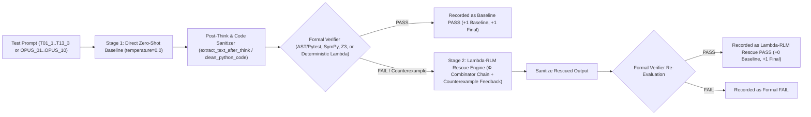
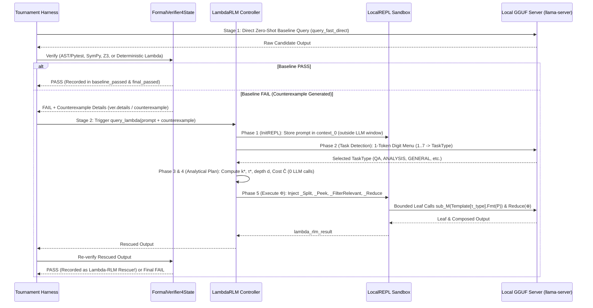

# AetherMind Bare-Metal Benchmark Suite Specification: 13 Cognitive Areas (39 Tests) & 10 Opus Hard Algorithmic Challenges

> **Canonical Reference Specification — Protocolo O.M.E.G.A. & Radical Truth Protocol**
> **Architect & Commander:** Mestre Ruan
> **Source Suite Directory:** `./suite/` (`benchmark_13_areas_39_testes.py`, `duelo_nivel_opus_8b_vs_9b.py`, `tournament_pesos_mosca.py`, `tournament_k2_horizon.py`, `test_audit_pesos_mosca_completo.py`, `test_audit_k2_horizon.py`)
> **Formal Verification Engine:** `FormalVerifier4State` (Python AST + Isolated Subprocess Unit Assertions + SymPy Symbolic Algebra + Microsoft Z3 SMT Solver)
> **Recursive Recovery Runtime:** $\lambda\text{-RLM}$ (`LambdaRLM` Typed Functional Combinator Runtime)

---

## Table of Contents

1. [Executive Overview & Evaluation Architecture](#1-executive-overview--evaluation-architecture)
2. [Formal Verification Engine (`FormalVerifier4State`) & Normalization Pipeline](#2-formal-verification-engine-formalverifier4state--normalization-pipeline)
3. [Part I: The 13 Cognitive Areas & 39 Verbatim Tests (`T01_1` – `T13_3`)](#3-part-i-the-13-cognitive-areas--39-verbatim-tests-t01_1--t13_3)
   - [Area 01: Reflexo / Triagem (`01_reflexo_triagem`)](#area-01-reflexo--triagem-01_reflexo_triagem)
   - [Area 02: Engenharia de Código (`02_engenharia_codigo`)](#area-02-engenharia-de-código-02_engenharia_codigo)
   - [Area 03: Matemática & Provas (`03_matematica_provas`)](#area-03-matemática--provas-03_matematica_provas)
   - [Area 04: Automação de SO / RPA (`04_automacao_so_rpa`)](#area-04-automação-de-so--rpa-04_automacao_so_rpa)
   - [Area 05: Memória Perene (`05_memoria_perene`)](#area-05-memória-perene-05_memoria_perene)
   - [Area 06: Metacognição (`06_metacognicao`)](#area-06-metacognição-06_metacognicao)
   - [Area 07: Cadinho Red-Team (`07_cadinho_redteam`)](#area-07-cadinho-red-team-07_cadinho_redteam)
   - [Area 08: Síntese Vocal (`08_sintese_vocal`)](#area-08-síntese-vocal-08_sintese_vocal)
   - [Area 09: Multimodal & Visão (`09_multimodal_visao`)](#area-09-multimodal--visão-09_multimodal_visao)
   - [Area 10: Planejamento Deliberativo (`10_planejamento_deliberativo`)](#area-10-planejamento-deliberativo-10_planejamento_deliberativo)
   - [Area 11: Raciocínio Científico (`11_raciocinio_cientifico`)](#area-11-raciocínio-científico-11_raciocinio_cientifico)
   - [Area 12: Linguagem & Discurso (`12_linguagem_discurso`)](#area-12-linguagem--discurso-12_linguagem_discurso)
   - [Area 13: Governador de Hardware (`13_governador_hardware`)](#area-13-governador-de-hardware-13_governador_hardware)
4. [Part II: The 10 Opus Hard Algorithmic Challenges (`OPUS_01` – `OPUS_10`)](#4-part-ii-the-10-opus-hard-algorithmic-challenges-opus_01--opus_10)
   - [`OPUS_01_regex_plus_star_dot` — Pure Regex Engine with `.`, `*`, and `+` (Without `re`)](#opus_01_regex_plus_star_dot--01-motor-regex-puro-com---e--sem-módulo-re)
   - [`OPUS_02_parser_unario_potencia_direita` — Algebraic Expression Parser Without `eval()`](#opus_02_parser_unario_potencia_direita--02-parser-algébrico-sem-eval-c-unário-e--associativo-à-direita)
   - [`OPUS_03_dijkstra_k_pedagios_gratis` — 2D State-Space Dijkstra with Up to $K$ Free Edges](#opus_03_dijkstra_k_pedagios_gratis--03-dijkstra-2d-no-espaço-de-estados-até-k-arestas-grátis)
   - [`OPUS_04_maior_retangulo_matriz_binaria` — 2D Monotonic Stack Maximal Binary Rectangle](#opus_04_maior_retangulo_matriz_binaria--04-pilha-monotônica-2d-maior-retângulo-de-1s-em-matriz)
   - [`OPUS_05_bitmask_dp_tsp_aberto` — Bitmask DP Minimum Hamiltonian Path (Open TSP)](#opus_05_bitmask_dp_tsp_aberto--05-bitmask-dp-caminho-hamiltoniano-mínimo-tsp-aberto)
   - [`OPUS_06_mediana_dois_arrays_ordenados` — Partitioned Binary Search Median of Two Sorted Arrays](#opus_06_mediana_dois_arrays_ordenados--06-busca-particionada-mediana-de-dois-arrays-ordenados)
   - [`OPUS_07_maior_parenteses_valido_trap` — DP / Index-Stack Longest Valid Parentheses Substring](#opus_07_maior_parenteses_valido_trap--07-dppilha-de-índices-maior-substring-de-parênteses-válidos)
   - [`OPUS_08_trapping_rain_water` — Two-Pointers Trapping Rain Water](#opus_08_trapping_rain_water--08-two-pointers-água-da-chuva-retida-entre-barras)
   - [`OPUS_09_arvore_caminho_maximo_negativos` — Binary Tree Any-to-Any Maximum Path Sum with Negative Nodes](#opus_09_arvore_caminho_maximo_negativos--09-árvore-binária-maior-soma-de-caminho-any-to-any-c-negativos)
   - [`OPUS_10_solver_dpll_sat_cnf` — DPLL Boolean Satisfiability (SAT) Solver for CNF Formulas](#opus_10_solver_dpll_sat_cnf--10-solver-lógico-dpll-sat-para-fórmulas-cnf)
5. [Part III: Mechanics of $\lambda\text{-RLM}$ (`Lambda-RLM`) Rescue & Counterexample-Guided Repair](#5-part-iii-mechanics-of-lambda-rlm-lambda-rlm-rescue--counterexample-guided-repair)
6. [Suite Scripts & Empirical Audit Harnesses in `./suite/`](#6-suite-scripts--empirical-audit-harnesses-in-suite)

---

## 1. Executive Overview & Evaluation Architecture

The AetherMind Bare-Metal Benchmark Suite evaluates local GGUF language models across two complementary axes of intelligence and algorithmic rigor on real hardware (AMD Radeon RX 580 8GB GDDR5 via Vulkan and Intel Xeon E5-2697 v3 14C/28T Haswell-EP via AVX2):

1. **The 13 Cognitive Areas Suite (`BENCHMARK_SUITE` — 39 Tests):**
   - Evaluates operational AGI breadth across **13 distinct cognitive domains**, with exactly **3 deterministic tests per area** ($13 \times 3 = 39$ tests per model).
   - Spans low-latency intent triage, Python software engineering, symbolic mathematics (SymPy) and integer constraint satisfaction (Microsoft Z3 SMT), closed-loop OS/RPA desktop automation, HippoRAG/KAIROS graph memory, LTI discrete metacognition, Red-Team security auditing, TTS phonetic/SSML prosody normalization, screen geometry & OCR de-noising, PDDL causal/topological planning, scientific reasoning (physics, stoichiometry, Roofline memory bandwidth), formal syllogistic/anaphoric discourse, and bare-metal hardware governor protection.
2. **The 10 Opus Hard Algorithmic Challenges (`OPUS_10_TESTS` — 10 Tests):**
   - Evaluates deep algorithmic synthesis and edge-case resilience at a competitive programming / Grandmaster tier.
   - Prohibits trivial library shortcuts (e.g., `inspect.getsource` assertions explicitly ban `import re` in `OPUS_01` and `eval()`/`exec()` in `OPUS_02`).
   - Enforces adversarial boundary conditions (e.g., single negative root node `{'v': -3, 'l': None, 'r': None}` in `OPUS_09`, right-associative exponentiation `2 ^ 3 ^ 2 == 512` in `OPUS_02`, broken contiguous parentheses `'()(()' == 2` in `OPUS_07`, and explicit `UNSAT` detection returning `None` in `OPUS_10`).



---

## 2. Formal Verification Engine (`FormalVerifier4State`) & Normalization Pipeline

No test in the suite relies on subjective LLM-as-a-judge scoring. Every test is verified by deterministic code execution, symbolic algebra, SMT solving, or exact lexical predicates.

### 2.1 Canonical 4-State Verification Report
Defined in `router/formal_verifier.py`, `FormalVerifier4State` classifies every candidate evaluation into one of four mutually exclusive formal states:
- **`PASS`**: Formally proven equivalent (SymPy), satisfied all integer equations (Z3 SMT), or passed Python AST parsing and 100% of unit test assertions in an isolated subprocess with exit code `0`.
- **`FAIL`**: Disproven with an explicit, actionable counterexample (`FAIL_ASSERTION[idx]`, `RUNTIME_ERROR[idx]`, `SyntaxError`, algebraic residual $\neq 0$, or violated Z3 constraint).
- **`UNKNOWN`**: Output could not be parsed into a strict mathematical expression or structured dictionary.
- **`BLOCKED`**: Missing solver dependency, subprocess execution timeout (`TimeoutExpired` — infinite loop detection), or contradictory `UNSAT` premise.

### 2.2 Normalization & Sanitization Helpers
Before passing a model's output to the verifier, the tournament harnesses apply three deterministic transformations:

1. **Unicode & Case Normalization (`_norm` in `benchmark_13_areas_39_testes.py`)**:
   ```python
   def _norm(s: str) -> str:
       s = unicodedata.normalize("NFKD", s).encode("ascii", "ignore").decode("ascii")
       return s.lower().strip()
   ```
   Strips diacritics/accents (e.g., `"quilômetros"` $\rightarrow$ `"quilometros"`, `"hipótese"` $\rightarrow$ `"hipotese"`), converts to ASCII lowercase, and trims whitespace.

2. **Chain-of-Thought Stripping (`extract_text_after_think`)**:
   For reasoning/thinking models that emit `<think>...</think>` blocks, the harness strips internal reasoning traces so only the final committed answer is verified:
   ```python
   def extract_text_after_think(text: str) -> str:
       if "</think>" in text:
           post = text.split("</think>", 1)[1].strip()
           if post:
               return post
       cleaned = re.sub(r"<think>[\s\S]*?</think>", "", text, flags=re.IGNORECASE).strip()
       if "<think>" in cleaned.lower():
           cleaned = re.sub(r"<think>", "", cleaned, flags=re.IGNORECASE).strip()
       return cleaned if cleaned else text.strip()
   ```

3. **Python Code Block Extraction (`clean_python_code` & `_extract_code_block`)**:
   Strips `<think>` traces, extracts fenced ` ```python ... ``` ` blocks (or JSON `"code"` fields when Grammar Fast-Forwarding is active), and trims leading conversational prose prior to the first `import`, `from`, `def`, or `class` statement.

### 2.3 Verification Modalities

| Modality | Engine Method | Mechanism | Used In |
| :--- | :--- | :--- | :--- |
| **Deterministic Predicate** | `test["verify"](out)` | Exact normalized substring, conjunction of numeric tokens, word-count check, or regular expression boundary match. | `T01_1`–`T01_3`, `T04_1`–`T13_3` (33 tests) |
| **Python AST + Subprocess Assertions** | `formal_verifier.verify_python_code(code, assertions, timeout_s)` | Parses `ast.parse(code)` to catch `SyntaxError`, appends each `assert` inside a labeled `try/except` harness, and executes in an isolated `subprocess.run([sys.executable, tmp_path])`. | `T02_1`–`T02_3` (3 tests) & `OPUS_01`–`OPUS_10` (10 tests) |
| **Symbolic Algebraic Equivalence** | `formal_verifier.verify_math_equivalence(out, expected_expr)` | Extracts expression, normalizes implicit multiplication (`6x` $\rightarrow$ `6*x`) and `^` $\rightarrow$ `**`, parses via `sympy.sympify`, and checks `sympy.simplify(expr_cand - expr_exp) == 0`. If non-zero, substitutes test points $x \in \{2, 3, -1, 5, 1\}$ to synthesize a numerical counterexample. | `T03_1`, `T03_2` (2 tests) |
| **Z3 SMT Integer Constraints** | `formal_verifier.verify_z3_constraints(out, constraints_spec)` | Extracts JSON assignment dictionary `{"x": int, "y": int}`, evaluates each constraint in a restricted builtin-free environment, and cross-checks satisfiability with `z3.Solver()`. | `T03_3` (1 test) |

---

## 3. Part I: The 13 Cognitive Areas & 39 Verbatim Tests (`T01_1` – `T13_3`)

Below is the complete, verbatim specification of all 13 Cognitive Areas and all 39 tests defined in `suite/benchmark_13_areas_39_testes.py`.

### Summary Matrix of the 13 Cognitive Areas

| Area ID | Area Name | Tests | Primary Verification Modality |
| :--- | :--- | :---: | :--- |
| `01_reflexo_triagem` | 01. Reflexo / Triagem (Intenção e despacho ágil) | `T01_1`, `T01_2`, `T01_3` | Deterministic Lexical / JSON / Delimiter Predicate |
| `02_engenharia_codigo` | 02. Engenharia de Código (Código, Refactor, Patches) | `T02_1`, `T02_2`, `T02_3` | Formal Python AST + Isolated Subprocess Unit Assertions |
| `03_matematica_provas` | 03. Matemática & Provas (Raciocínio formal e cálculo) | `T03_1`, `T03_2`, `T03_3` | SymPy Symbolic Equivalence (`T03_1`, `T03_2`) & Z3 SMT (`T03_3`) |
| `04_automacao_so_rpa` | 04. Automação de SO / RPA (Desktop, telas, janelas) | `T04_1`, `T04_2`, `T04_3` | Deterministic Coordinate / Policy / Cmdlet Predicate |
| `05_memoria_perene` | 05. Memória Perene (Conhecimento contínuo e Grafo) | `T05_1`, `T05_2`, `T05_3` | Deterministic Graph Triple / Temporal KAIROS / Regex Boundary |
| `06_metacognicao` | 06. Metacognição (Auto-correção e estabilidade LTI) | `T06_1`, `T06_2`, `T06_3` | Deterministic Contradiction / Numerical / Spectral Radius Predicate |
| `07_cadinho_redteam` | 07. Cadinho Red-Team (Fuzzing, segurança e auditoria) | `T07_1`, `T07_2`, `T07_3` | Deterministic Vulnerability & Remediation Classification |
| `08_sintese_vocal` | 08. Síntese Vocal (Normalização fonética e prosódia TTS) | `T08_1`, `T08_2`, `T08_3` | Deterministic Portuguese Phonetic & SSML Tag Verification |
| `09_multimodal_visao` | 09. Multimodal & Visão (Geometria de tela, SVG, OCR) | `T09_1`, `T09_2`, `T09_3` | Deterministic Bounding-Box Area, SVG Geometry & OCR Restoration |
| `10_planejamento_deliberativo` | 10. Planejamento Deliberativo (Planos encadeados e PDDL) | `T10_1`, `T10_2`, `T10_3` | Deterministic Regex Sequence (`B->A->C`, `3->2->1`) & Concurrency |
| `11_raciocinio_cientifico` | 11. Raciocínio Científico (Física, Química, Engenharia) | `T11_1`, `T11_2`, `T11_3` | Deterministic Word-Boundary Numerical Regex (`\b90\b`, `\b6\b`, `\b20\b`) |
| `12_linguagem_discurso` | 12. Linguagem & Discurso (Coerência, síntese e lógica verbal) | `T12_1`, `T12_2`, `T12_3` | Deterministic Token Length Constraint, Syllogism & Anaphora |
| `13_governador_hardware` | 13. Governador de Hardware (Clocks, temperaturas e VRAM) | `T13_1`, `T13_2`, `T13_3` | Deterministic Hardware Circuit-Breaker, Thermal & SIMD Policy |

---

### Area 01: Reflexo / Triagem (`01_reflexo_triagem`)
**Full Title:** `01. Reflexo / Triagem (Intenção e despacho ágil)`
**Cognitive Scope:** Ultra-fast alert classification, complexity-based tier routing, and structured entity extraction under tight token budgets (`n_predict: 24`).

#### `T01_1` — Classificação de Emergência Infra
- **Evaluation Type:** Deterministic Normalized Substring Predicate
- **Token Budget (`n_predict`):** `24`
- **Verbatim Prompt:**
  ```text
  /no_think Classifique o alerta 'O banco PostgreSQL parou por disco cheio' escolhendo APENAS UMA etiqueta entre: INFRA_EMERGENCY, CHITCHAT, MATH. Responda somente a etiqueta.
  ```
- **Exact Validation Criterion:**
  ```python
  lambda out: "infra_emergency" in _norm(out)
  ```

#### `T01_2` — Despacho de Tier por Complexidade
- **Evaluation Type:** Deterministic JSON / Token Predicate
- **Token Budget (`n_predict`):** `24`
- **Verbatim Prompt:**
  ```text
  /no_think Para a tarefa "Prove o Teorema de Incompletude e implemente o verificador formal", escolha o tier em JSON exato {"tier": 2} (Tier 2 Pesado) ou {"tier": 0} (Trivial). Responda apenas o JSON.
  ```
- **Exact Validation Criterion:**
  ```python
  lambda out: '"tier": 2' in out or '"tier":2' in out or "2" in out
  ```

#### `T01_3` — Extração Léxica Rápida
- **Evaluation Type:** Deterministic Dual-Entity Extraction Predicate
- **Token Budget (`n_predict`):** `24`
- **Verbatim Prompt:**
  ```text
  /no_think Extraia o valor numérico e a conta da frase "Transferir 450 para conta 9981" no formato exato 450|9981. Responda apenas os números separados por barra vertical.
  ```
- **Exact Validation Criterion:**
  ```python
  lambda out: "450" in out and "9981" in out
  ```

---

### Area 02: Engenharia de Código (`02_engenharia_codigo`)
**Full Title:** `02. Engenharia de Código (Código, Refactor, Patches)`
**Cognitive Scope:** Synthesizing executable, bug-free Python algorithms (binary search, normalized string palindrome, and dynamic programming non-adjacent maximum sum) verified via AST parsing and isolated subprocess assertions.

#### `T02_1` — Busca Binária Exata
- **Evaluation Type:** Formal Python AST + Isolated Subprocess Unit Assertions (`formal_verifier.verify_python_code`)
- **Token Budget (`n_predict`):** `160` | **Schema Type:** `"python_func"`
- **Verbatim Prompt:**
  ```text
  /no_think Escreva em Python apenas a função `busca_binaria(arr, x)` (sem comentários) que retorna o índice de `x` na lista ordenada `arr` ou -1 se não existir.
  ```
- **Exact Validation Criterion & Assertions:**
  ```python
  lambda out: formal_verifier.verify_python_code(
      out,
      [
          "assert busca_binaria([1, 3, 5, 7, 9], 7) == 3",
          "assert busca_binaria([1, 3, 5], 4) == -1",
      ],
  ).passed
  ```

#### `T02_2` — Patch de Palíndromo Normalizado
- **Evaluation Type:** Formal Python AST + Isolated Subprocess Unit Assertions (`formal_verifier.verify_python_code`)
- **Token Budget (`n_predict`):** `160` | **Schema Type:** `"python_func"`
- **Verbatim Prompt:**
  ```text
  /no_think Escreva em Python apenas a função `eh_palindromo(s)` (sem comentários) que retorna True se a string `s` for palíndromo ignorando espaços e maiúsculas/minúsculas, ou False caso contrário.
  ```
- **Exact Validation Criterion & Assertions:**
  ```python
  lambda out: formal_verifier.verify_python_code(
      out,
      [
          "assert eh_palindromo('Ame a ema') is True",
          "assert eh_palindromo('rotor') is True",
          "assert eh_palindromo('python') is False",
      ],
  ).passed
  ```

#### `T02_3` — Programação Dinâmica (Maior Soma Não-Adjacente)
- **Evaluation Type:** Formal Python AST + Isolated Subprocess Unit Assertions (`formal_verifier.verify_python_code`)
- **Token Budget (`n_predict`):** `160` | **Schema Type:** `"python_func"`
- **Verbatim Prompt:**
  ```text
  /no_think Escreva em Python apenas a função `max_nao_adj(nums)` (sem comentários) que retorna a maior soma de elementos não-adjacentes da lista `nums` (para [] retorna 0, para [2, 1, 1, 2] retorna 4).
  ```
- **Exact Validation Criterion & Assertions:**
  ```python
  lambda out: formal_verifier.verify_python_code(
      out,
      [
          "assert max_nao_adj([]) == 0",
          "assert max_nao_adj([2, 7, 9, 3, 1]) == 12",
          "assert max_nao_adj([2, 1, 1, 2]) == 4",
      ],
  ).passed
  ```

---

### Area 03: Matemática & Provas (`03_matematica_provas`)
**Full Title:** `03. Matemática & Provas (Raciocínio formal e cálculo)`
**Cognitive Scope:** Symbolic polynomial algebra, differential calculus verified by `SymPy`, and simultaneous linear Diophantine constraint solving verified by `Microsoft Z3 SMT`.

#### `T03_1` — Expansão Polinomial Simbólica (SymPy)
- **Evaluation Type:** Symbolic Algebraic Equivalence via SymPy (`formal_verifier.verify_math_equivalence`)
- **Token Budget (`n_predict`):** `48` | **Schema Type:** `"concise_json"`
- **Verbatim Prompt:**
  ```text
  /no_think Expanda algebricamente (2*x - 3)**2 em polinômio simplificado em x. Responda apenas a expressão no JSON.
  ```
- **Exact Validation Criterion:**
  ```python
  lambda out: formal_verifier.verify_math_equivalence(out, "4*x**2 - 12*x + 9").passed
  ```
  *(Verified symbolically in SymPy by checking `simplify((candidate) - (4*x**2 - 12*x + 9)) == 0`.)*

#### `T03_2` — Derivada Simbólica (SymPy)
- **Evaluation Type:** Symbolic Algebraic Equivalence via SymPy (`formal_verifier.verify_math_equivalence`)
- **Token Budget (`n_predict`):** `48` | **Schema Type:** `"concise_json"`
- **Verbatim Prompt:**
  ```text
  /no_think Calcule a derivada primeira em relação a x da função f(x) = x**3 - 5*x**2 + 6*x - 2. Responda apenas a expressão derivada no JSON.
  ```
- **Exact Validation Criterion:**
  ```python
  lambda out: formal_verifier.verify_math_equivalence(out, "3*x**2 - 10*x + 6").passed
  ```
  *(Verified symbolically in SymPy by checking `simplify((candidate) - (3*x**2 - 10*x + 6)) == 0`.)*

#### `T03_3` — Sistema de Restrições Inteira (Z3 SMT)
- **Evaluation Type:** Formal Integer Constraint Satisfaction via Microsoft Z3 (`formal_verifier.verify_z3_constraints`)
- **Token Budget (`n_predict`):** `36` | **Schema Type:** `"z3_xy"`
- **Verbatim Prompt:**
  ```text
  /no_think Encontre inteiros x e y tais que x + y == 30 e 2*x - y == 15. Responda apenas no JSON {"solution":{"x": valor, "y": valor}}.
  ```
- **Exact Validation Criterion:**
  ```python
  lambda out: formal_verifier.verify_z3_constraints(
      out, ["x + y == 30", "2*x - y == 15"]
  ).passed
  ```
  *(Unique integer solution verified against Z3 constraints: $x = 15, y = 15$.)*

---

### Area 04: Automação de SO / RPA (`04_automacao_so_rpa`)
**Full Title:** `04. Automação de SO / RPA (Desktop, telas, janelas)`
**Cognitive Scope:** Closed-loop visual OCR coordinate grounding, strict adherence to the Zero Open-Loop RPA Law (refusing blind clicks when expected UI elements are absent), and native Windows PowerShell process introspection.

#### `T04_1` — Seleção de Coordenada OCR Closed-Loop
- **Evaluation Type:** Deterministic Coordinate Extraction Predicate
- **Token Budget (`n_predict`):** `24`
- **Verbatim Prompt:**
  ```text
  /no_think O OCR da tela detectou: [{"text":"Salvar","x":420,"y":310},{"text":"Cancelar","x":520,"y":310}]. Qual o par x,y exato para clicar em Salvar? Responda apenas 420,310.
  ```
- **Exact Validation Criterion:**
  ```python
  lambda out: "420" in out and "310" in out
  ```

#### `T04_2` — Prevenção de Clique Cego (Zero Open-Loop)
- **Evaluation Type:** Deterministic Policy Classification Predicate
- **Token Budget (`n_predict`):** `24`
- **Verbatim Prompt:**
  ```text
  /no_think Precisamos clicar no botão "Confirmar", mas o OCR atual da tela só mostra [{"text":"Carregando..."}]. Pela regra de Tolerância Zero a RPA Cego, escolha APENAS UMA ação: WAIT_AND_RESCAN ou BLIND_CLICK.
  ```
- **Exact Validation Criterion:**
  ```python
  lambda out: "wait_and_rescan" in _norm(out)
  ```

#### `T04_3` — Cmdlet Nativo PowerShell de Processos
- **Evaluation Type:** Deterministic OS Command Identification Predicate
- **Token Budget (`n_predict`):** `24`
- **Verbatim Prompt:**
  ```text
  /no_think Qual é o nome exato do cmdlet nativo do PowerShell (Verbo-Substantivo) usado para listar os processos em execução no Windows? Responda apenas o cmdlet.
  ```
- **Exact Validation Criterion:**
  ```python
  lambda out: "get-process" in _norm(out)
  ```

---

### Area 05: Memória Perene (`05_memoria_perene`)
**Full Title:** `05. Memória Perene (Conhecimento contínuo e Grafo)`
**Cognitive Scope:** Knowledge graph entity-relation extraction (HippoRAG), temporal state conflict resolution (KAIROS recency precedence), and semantic fact deduplication.

#### `T05_1` — Extração de Tripla para Grafo HippoRAG
- **Evaluation Type:** Deterministic Graph Entity Presence Predicate
- **Token Budget (`n_predict`):** `48`
- **Verbatim Prompt:**
  ```text
  /no_think Extraia a tripla da frase "O Xeon E5-2697 v3 possui arquitetura Haswell-EP" em formato JSON contendo "Xeon E5-2697 v3" e "Haswell-EP". Responda apenas o JSON.
  ```
- **Exact Validation Criterion:**
  ```python
  lambda out: "xeon" in _norm(out) and "haswell" in _norm(out)
  ```

#### `T05_2` — Resolução de Conflito Temporal (KAIROS)
- **Evaluation Type:** Deterministic Temporal Precedence & Anti-Stale Predicate
- **Token Budget (`n_predict`):** `24`
- **Verbatim Prompt:**
  ```text
  /no_think Memória t=1: 'A porta ativa do servidor é 8080'. Memória t=2 (mais recente): 'A porta ativa foi migrada para 8083'. Qual é o número da porta ativa atual? Responda apenas o número.
  ```
- **Exact Validation Criterion:**
  ```python
  lambda out: "8083" in out and "8080" not in out.strip()[:6]
  ```

#### `T05_3` — Deduplicação de Fatos Redundantes
- **Evaluation Type:** Deterministic Word-Boundary Regex Predicate
- **Token Budget (`n_predict`):** `20`
- **Verbatim Prompt:**
  ```text
  /no_think Temos 3 registros: (1) 'A RX 580 tem 8GB de VRAM', (2) 'O chip é Polaris 20', (3) 'A memória de vídeo da RX 580 é de 8GB'. Após deduplicar sinônimos, quantos fatos distintos restam? Responda apenas o número inteiro.
  ```
- **Exact Validation Criterion:**
  ```python
  lambda out: re.search(r"\b2\b", out) is not None
  ```

---

### Area 06: Metacognição (`06_metacognicao`)
**Full Title:** `06. Metacognição (Auto-correção e estabilidade LTI)`
**Cognitive Scope:** Detecting logically unsatisfiable premises, correcting numerical hallucinations in prior drafts, and verifying Linear Time-Invariant (LTI) state-space asymptotic stability criteria ($\rho(A) < 1$).

#### `T06_1` — Detecção de Premissa Contraditória
- **Evaluation Type:** Deterministic Logical Contradiction Predicate
- **Token Budget (`n_predict`):** `24`
- **Verbatim Prompt:**
  ```text
  /no_think Um problema pede: 'Encontre um número inteiro que seja simultaneamente par e ímpar'. Essa tarefa tem solução numérica ou é IMPOSSIVEL por contradição lógica? Responda apenas IMPOSSIVEL se for contraditória.
  ```
- **Exact Validation Criterion:**
  ```python
  lambda out: any(k in _norm(out) for k in ("impossivel", "contradic", "nao existe"))
  ```

#### `T06_2` — Auto-Correção de Alucinação Numérica
- **Evaluation Type:** Deterministic Numerical Verification Predicate
- **Token Budget (`n_predict`):** `24`
- **Verbatim Prompt:**
  ```text
  /no_think Um rascunho anterior afirmou erroneamente que 2 elevado a 10 (2**10) é 1000. Corrija o erro e responda apenas o valor inteiro exato de 2**10.
  ```
- **Exact Validation Criterion:**
  ```python
  lambda out: "1024" in out
  ```

#### `T06_3` — Critério de Estabilidade LTI Discreta
- **Evaluation Type:** Deterministic Control-Theory Stability Predicate
- **Token Budget (`n_predict`):** `24`
- **Verbatim Prompt:**
  ```text
  /no_think Para um sistema dinâmico linear discreto h_{t+1} = A * h_t convergir de forma assintoticamente estável sem explodir, o raio espectral rho(A) deve ser MENOR_QUE_1 ou MAIOR_QUE_1? Responda apenas uma das opções.
  ```
- **Exact Validation Criterion:**
  ```python
  lambda out: "menor" in _norm(out) or "< 1" in out or "<1" in out
  ```

---

### Area 07: Cadinho Red-Team (`07_cadinho_redteam`)
**Full Title:** `07. Cadinho Red-Team (Fuzzing, segurança e auditoria)`
**Cognitive Scope:** Static vulnerability detection (SQL Injection via f-strings), safe deserialization replacement for `eval()` RCE payloads, and fuzzing attack vector classification (Path Traversal vs. CSRF).

#### `T07_1` — Auditoria de SQL Injection
- **Evaluation Type:** Deterministic Vulnerability Classification Predicate
- **Token Budget (`n_predict`):** `24`
- **Verbatim Prompt:**
  ```text
  /no_think Qual vulnerabilidade clássica existe na linha Python `cursor.execute(f"SELECT * FROM users WHERE user = '{nome}'")`? Responda apenas SQL_INJECTION ou BUFFER_OVERFLOW.
  ```
- **Exact Validation Criterion:**
  ```python
  lambda out: "sql" in _norm(out)
  ```

#### `T07_2` — Detecção de RCE via eval()
- **Evaluation Type:** Deterministic Remediation Function Predicate
- **Token Budget (`n_predict`):** `24`
- **Verbatim Prompt:**
  ```text
  /no_think Receber uma string JSON da internet e passá-la diretamente para `eval(payload)` em Python causa risco crítico de Execução Remota de Código (RCE). Qual função segura da biblioteca padrão `json` deve substituir `eval`? Responda apenas o nome da função.
  ```
- **Exact Validation Criterion:**
  ```python
  lambda out: "loads" in _norm(out)
  ```

#### `T07_3` — Classificação de Path Traversal
- **Evaluation Type:** Deterministic Attack Vector Predicate
- **Token Budget (`n_predict`):** `24`
- **Verbatim Prompt:**
  ```text
  /no_think Um fuzzer envia o parâmetro `arquivo=../../../../Windows/win.ini` para uma rota de leitura. Esse vetor de ataque é PATH_TRAVERSAL ou CSRF? Responda apenas o nome do ataque.
  ```
- **Exact Validation Criterion:**
  ```python
  lambda out: "path_traversal" in _norm(out) or "traversal" in _norm(out)
  ```

---

### Area 08: Síntese Vocal (`08_sintese_vocal`)
**Full Title:** `08. Síntese Vocal (Normalização fonética e prosódia TTS)`
**Cognitive Scope:** Converting currency and physical velocity units into full Portuguese phonetic words for OMEGA TTS synthesis, and injecting precise SSML prosodic break tags.

#### `T08_1` — Expansão Monetária para TTS
- **Evaluation Type:** Deterministic Normalized Phonetic String Predicate
- **Token Budget (`n_predict`):** `36`
- **Verbatim Prompt:**
  ```text
  /no_think Converta o valor 'R$ 15,50' para texto escrito integralmente por extenso em português para leitura por sintetizador de voz. Responda apenas o texto por extenso.
  ```
- **Exact Validation Criterion:**
  ```python
  lambda out: "quinze reais" in _norm(out) and "cinquenta centavos" in _norm(out)
  ```

#### `T08_2` — Expansão de Unidade Física para TTS
- **Evaluation Type:** Deterministic Normalized Phonetic String Predicate
- **Token Budget (`n_predict`):** `32`
- **Verbatim Prompt:**
  ```text
  /no_think Escreva '100 km/h' totalmente por extenso em português para leitura natural em voz alta. Responda apenas a frase por extenso.
  ```
- **Exact Validation Criterion:**
  ```python
  lambda out: "cem quilometros por hora" in _norm(out)
  ```

#### `T08_3` — Inserção de Tag SSML de Pausa
- **Evaluation Type:** Deterministic SSML Tag & Attribute Predicate
- **Token Budget (`n_predict`):** `36`
- **Verbatim Prompt:**
  ```text
  /no_think Insira a tag SSML `<break time="500ms"/>` exatamente entre as palavras "Concluído." e "Iniciando" na frase "Concluído. Iniciando". Responda apenas a frase resultante.
  ```
- **Exact Validation Criterion:**
  ```python
  lambda out: "<break" in _norm(out) and "500ms" in _norm(out)
  ```

---

### Area 09: Multimodal & Visão (`09_multimodal_visao`)
**Full Title:** `09. Multimodal & Visão (Geometria de tela, SVG, OCR)`
**Cognitive Scope:** 2D bounding-box intersection area calculation, SVG primitive geometric attribute parsing, and restoring noisy OCR leetspeak corruption into clean Portuguese text.

#### `T09_1` — Cálculo de Área de Interseção (Bounding Boxes)
- **Evaluation Type:** Deterministic Formatted Number Predicate
- **Token Budget (`n_predict`):** `24`
- **Verbatim Prompt:**
  ```text
  /no_think Duas janelas na tela têm coordenadas [x1, y1, x2, y2]: Janela A = [0, 0, 100, 100] e Janela B = [50, 50, 150, 150]. A interseção é o quadrado [50, 50, 100, 100] de lado 50x50. Qual é a área numérica dessa interseção? Responda apenas o número.
  ```
- **Exact Validation Criterion:**
  ```python
  lambda out: "2500" in out.replace(".", "").replace(",", "")
  ```

#### `T09_2` — Inspeção Geométrica de Código SVG
- **Evaluation Type:** Deterministic Word-Boundary Regex Predicate
- **Token Budget (`n_predict`):** `24`
- **Verbatim Prompt:**
  ```text
  /no_think Analise o elemento `<svg><circle cx="100" cy="100" r="40" fill="blue"/></svg>`. Sabendo que o raio r é 40, qual é o valor numérico do diâmetro (2 * r) desse círculo? Responda apenas o número.
  ```
- **Exact Validation Criterion:**
  ```python
  lambda out: re.search(r"\b80\b", out) is not None
  ```

#### `T09_3` — Restauração de Texto OCR com Ruído Leetspeak
- **Evaluation Type:** Deterministic Normalized String Restoration Predicate
- **Token Budget (`n_predict`):** `28`
- **Verbatim Prompt:**
  ```text
  /no_think Restaure o texto corrompido por OCR 'O s1st3m4 f0i v4l1d4d0' para o português correto. Responda apenas a frase limpa.
  ```
- **Exact Validation Criterion:**
  ```python
  lambda out: "o sistema foi validado" in _norm(out)
  ```

---

### Area 10: Planejamento Deliberativo (`10_planejamento_deliberativo`)
**Full Title:** `10. Planejamento Deliberativo (Planos encadeados e PDDL)`
**Cognitive Scope:** Directed acyclic graph (DAG) topological sorting of build dependencies, PDDL precondition ordering for encrypted storage mounting, and formal OS concurrency deadlock diagnosis.

#### `T10_1` — Ordenação Topológica de Dependências
- **Evaluation Type:** Deterministic Regular Expression Sequence Predicate
- **Token Budget (`n_predict`):** `24`
- **Verbatim Prompt:**
  ```text
  /no_think Temos 3 etapas: [A: Compilar DLL (exige B pronta)], [B: Escrever código C++ (sem dependências)], [C: Rodar teste Python (exige A pronta)]. Qual a ordem correta de execução? Responda apenas B->A->C.
  ```
- **Exact Validation Criterion:**
  ```python
  lambda out: re.search(r"b\s*(?:->|,|>|-|\s)\s*a\s*(?:->|,|>|-|\s)\s*c", _norm(out)) is not None
  ```

#### `T10_2` — Sequenciamento Causal PDDL
- **Evaluation Type:** Deterministic Regular Expression Sequence Predicate
- **Token Budget (`n_predict`):** `24`
- **Verbatim Prompt:**
  ```text
  /no_think Para ler um arquivo dentro de um disco criptografado desmontado, ordene os passos 1 (Ler arquivo), 2 (Desbloquear criptografia), 3 (Conectar disco físico) na sequência lógica correta. Responda apenas 3->2->1.
  ```
- **Exact Validation Criterion:**
  ```python
  lambda out: re.search(r"3\s*(?:->|,|>|-|\s)\s*2\s*(?:->|,|>|-|\s)\s*1", _norm(out)) is not None
  ```

#### `T10_3` — Diagnóstico Formal de Deadlock
- **Evaluation Type:** Deterministic Concurrency Hazard Classification Predicate
- **Token Budget (`n_predict`):** `24`
- **Verbatim Prompt:**
  ```text
  /no_think O Processo A segura o Lock 1 e aguarda o Lock 2; simultaneamente, o Processo B segura o Lock 2 e aguarda o Lock 1. Como é chamado esse travamento circular em sistemas operacionais? Responda apenas DEADLOCK ou RACE_CONDITION.
  ```
- **Exact Validation Criterion:**
  ```python
  lambda out: "deadlock" in _norm(out)
  ```

---

### Area 11: Raciocínio Científico (`11_raciocinio_cientifico`)
**Full Title:** `11. Raciocínio Científico (Física, Química, Engenharia)`
**Cognitive Scope:** Joule heating power dissipation ($P = I^2 R$), stoichiometric molar balancing of methane combustion, and Roofline memory bandwidth token generation limits.

#### `T11_1` — Física: Dissipação de Potência (P = I^2 * R)
- **Evaluation Type:** Deterministic Word-Boundary Numerical Regex Predicate
- **Token Budget (`n_predict`):** `24`
- **Verbatim Prompt:**
  ```text
  /no_think Um resistor de R = 10 Ohms é percorrido por uma corrente elétrica de I = 3 Amperes. Pela fórmula P = (I**2) * R, qual a potência dissipada em Watts? Responda apenas o número.
  ```
- **Exact Validation Criterion:**
  ```python
  lambda out: re.search(r"\b90\b", out) is not None
  ```

#### `T11_2` — Química: Balanceamento Estequiométrico
- **Evaluation Type:** Deterministic Word-Boundary Numerical Regex Predicate
- **Token Budget (`n_predict`):** `24`
- **Verbatim Prompt:**
  ```text
  /no_think Na reação balanceada de combustão do metano: CH4 + 2 O2 -> CO2 + 2 H2O, a queima completa de 3 mols de CH4 produz quantos mols de água (H2O)? Responda apenas o número inteiro.
  ```
- **Exact Validation Criterion:**
  ```python
  lambda out: re.search(r"\b6\b", out) is not None
  ```

#### `T11_3` — Engenharia: Teto de Largura de Banda (Roofline)
- **Evaluation Type:** Deterministic Word-Boundary Numerical Regex Predicate
- **Token Budget (`n_predict`):** `24`
- **Verbatim Prompt:**
  ```text
  /no_think Se um modelo lê 4 GB de pesos por token gerado e a memória entrega 80 GB/s de largura de banda efetiva, qual é a velocidade máxima teórica em tokens por segundo (80 / 4)? Responda apenas o número.
  ```
- **Exact Validation Criterion:**
  ```python
  lambda out: re.search(r"\b20\b", out) is not None
  ```

---

### Area 12: Linguagem & Discurso (`12_linguagem_discurso`)
**Full Title:** `12. Linguagem & Discurso (Coerência, síntese e lógica verbal)`
**Cognitive Scope:** Length-constrained telemetry compression preserving floating-point data, strict Aristotelian syllogistic deduction (Polaris 20 Wave64 execution), and grammatical anaphora resolution.

#### `T12_1` — Compressão Densa de Telemetria
- **Evaluation Type:** Deterministic Numerical Retention & Word-Count Constraint Predicate
- **Token Budget (`n_predict`):** `24`
- **Verbatim Prompt:**
  ```text
  /no_think Comprima a frase 'O processador Xeon finalizou o benchmark atingindo a marca de 10.94 tokens por segundo' em no máximo 5 palavras mantendo o número 10.94. Responda apenas a frase curta.
  ```
- **Exact Validation Criterion:**
  ```python
  lambda out: ("10.94" in out or "10,94" in out) and len(out.strip().split()) <= 8
  ```

#### `T12_2` — Dedução Silogística Estrita
- **Evaluation Type:** Deterministic Syllogistic Conclusion Predicate
- **Token Budget (`n_predict`):** `24`
- **Verbatim Prompt:**
  ```text
  /no_think Premissa 1: Todos os shaders Polaris 20 executam em frentes de onda Wave64. Premissa 2: O kernel Q4_K_M é um shader Polaris 20. Conclusão lógica: o kernel Q4_K_M executa em Wave32 ou Wave64? Responda apenas Wave64 ou Wave32.
  ```
- **Exact Validation Criterion:**
  ```python
  lambda out: "wave64" in _norm(out)
  ```

#### `T12_3` — Resolução Correferencial (Anáfora)
- **Evaluation Type:** Deterministic Anaphoric Antecedent Predicate
- **Token Budget (`n_predict`):** `24`
- **Verbatim Prompt:**
  ```text
  /no_think Na frase 'O módulo descartou a hipótese porque ela violou a restrição Z3', o pronome 'ela' refere-se a 'módulo' ou a 'hipótese'? Responda apenas a palavra correta.
  ```
- **Exact Validation Criterion:**
  ```python
  lambda out: "hipotese" in _norm(out)
  ```

---

### Area 13: Governador de Hardware (`13_governador_hardware`)
**Full Title:** `13. Governador de Hardware (Clocks, temperaturas e VRAM)`
**Cognitive Scope:** VRAM Out-Of-Memory (OOM) admission control circuit-breaking, silicon thermal watchdog throttling policies, and physical core affinity pinning to prevent AVX2 SIMD register contention on Haswell-EP processors.

#### `T13_1` — Prevenção de OOM em VRAM (Circuit Breaker)
- **Evaluation Type:** Deterministic Admission Control Decision Predicate
- **Token Budget (`n_predict`):** `24`
- **Verbatim Prompt:**
  ```text
  /no_think A placa de vídeo possui 7.4 GB de VRAM útil. Uma requisição tenta alocar um modelo de 6.0 GB mais 2.5 GB de KV-Cache (total 8.5 GB > 7.4 GB). O Governador deve responder ALLOW ou REJECT_OOM? Responda apenas uma opção.
  ```
- **Exact Validation Criterion:**
  ```python
  lambda out: "reject" in _norm(out) or "oom" in _norm(out)
  ```

#### `T13_2` — Proteção Térmica (Hardware Watchdog)
- **Evaluation Type:** Deterministic Thermal Policy Predicate
- **Token Budget (`n_predict`):** `24`
- **Verbatim Prompt:**
  ```text
  /no_think A temperatura do silício da GPU atingiu 90°C (acima do teto seguro de 85°C). Qual política o Watchdog deve aplicar imediatamente: THROTTLE_AND_COOL ou OVERCLOCK_BOOST? Responda apenas a política correta.
  ```
- **Exact Validation Criterion:**
  ```python
  lambda out: "throttle" in _norm(out) or "cool" in _norm(out)
  ```

#### `T13_3` — Escalonamento de Núcleos Físicos AVX2
- **Evaluation Type:** Deterministic CPU Affinity Policy Predicate
- **Token Budget (`n_predict`):** `24`
- **Verbatim Prompt:**
  ```text
  /no_think Para evitar contenção de registradores SIMD AVX2 entre threads virtuais (HyperThreading) no Xeon Haswell, devemos fixar a afinidade apenas nos NUCLEOS_FISICOS ou em TODOS_THREADS_VIRTUAIS? Responda apenas a opção correta.
  ```
- **Exact Validation Criterion:**
  ```python
  lambda out: "fisicos" in _norm(out) or "nucleos_fisicos" in _norm(out)
  ```

---

## 4. Part II: The 10 Opus Hard Algorithmic Challenges (`OPUS_01` – `OPUS_10`)

Defined in `suite/duelo_nivel_opus_8b_vs_9b.py` and executed across all tournament contenders in `suite/tournament_pesos_mosca.py` and `suite/tournament_k2_horizon.py`, the **10 Opus Hard Challenges** test whether a language model can synthesize non-trivial computer science algorithms in pure Python without syntactic errors, banned standard-library shortcuts, or edge-case regressions.

Every challenge is validated by `formal_verifier.verify_python_code(code, test["assertions"], timeout_s=8.0)` (4.0s in the 8B vs 9B duel, 8.0s in the full tournament harnesses).

### Summary Table of the 10 Opus Hard Challenges

| Challenge ID | Function Signature | Algorithmic Domain | Key Edge-Case & Anti-Cheat Traps |
| :--- | :--- | :--- | :--- |
| `OPUS_01_regex_plus_star_dot` | `casamento_padrao(texto, padrao)` | Pure NFA/DP Regular Expression Engine (`.`, `*`, `+`) | Source inspection bans `re.`; `+` requires $\ge 1$ match while `*` allows $0$; full-string match required (`'mississippi'` trap). |
| `OPUS_02_parser_unario_potencia_direita` | `avaliar_expr(expr)` | Recursive Descent / Shunting-Yard Algebraic Parser | Source inspection bans `eval(` and `exec(`; unary minus (`-5 + 2`, `2 * (-3 + 1)`); right-associative exponentiation (`2 ^ 3 ^ 2 == 512`); integer floor division `//`. |
| `OPUS_03_dijkstra_k_pedagios_gratis` | `menor_custo_k_gratis(n, arestas, k)` | 2D State-Space Dijkstra Shortest Path $(u, \text{used\_free})$ | Bidirectional edges; state space $V \times \{0, \dots, k\}$; unreachable target returns `-1`; zero cost when $k \ge \text{path length}$. |
| `OPUS_04_maior_retangulo_matriz_binaria` | `maior_retangulo_binario(matriz)` | 2D Monotonic Stack / Histogram Maximal Rectangle | Empty matrix `[]` returns `0`; single-cell `[[0]]` and `[[1]]`; non-square sub-rectangles. |
| `OPUS_05_bitmask_dp_tsp_aberto` | `tsp_aberto(dist)` | Bitmask Dynamic Programming Open Travelling Salesperson | Starts at node `0`, visits all $N$ nodes once **without** returning to `0`; trivial $1 \times 1$ matrix `[[0]]` returns `0`. |
| `OPUS_06_mediana_dois_arrays_ordenados` | `mediana_ordenada(a, b)` | Partitioned Binary Search Median of Two Sorted Arrays | Must return exact `float`; handles odd/even combined lengths, empty array `[]`, and negative numbers. |
| `OPUS_07_maior_parenteses_valido_trap` | `maior_parenteses_valido(s)` | DP / Index-Stack Longest Valid Parentheses Substring | Classic `'()(()'` trap where naive counter yields `4` instead of `2`; empty string `''` returns `0`. |
| `OPUS_08_trapping_rain_water` | `agua_retida(alturas)` | Two-Pointers / Prefix-Suffix Max Trapping Rain Water | Monotonically decreasing `[3, 2, 1]` traps `0`; empty list `[]` traps `0`; multi-valley elevation map. |
| `OPUS_09_arvore_caminho_maximo_negativos` | `maior_caminho_arvore(raiz)` | Binary Tree Any-to-Any Maximum Path Sum | All-negative tree `{'v': -3, 'l': None, 'r': None}` must return `-3` (not `0`); negative leaf pruning `max(0, child)`. |
| `OPUS_10_solver_dpll_sat_cnf` | `resolver_sat_cnf(num_vars, clausulas)` | DPLL Boolean Satisfiability (SAT) Solver in CNF | Must return `{1: bool, ..., num_vars: bool}` on `SAT` and `None` on `UNSAT`; unit-propagation chain & contradictory clauses. |

---

### `OPUS_01_regex_plus_star_dot` — 01. Motor Regex Puro com '.', '*' e '+' (Sem módulo re)
- **Challenge ID:** `OPUS_01_regex_plus_star_dot`
- **Algorithmic Domain:** Formal Languages & Automata — Pure Dynamic Programming / Backtracking Regular Expression Engine supporting wildcard `.`, Kleene star `*` ($0$ or more), and Kleene plus `+` ($1$ or more) across the entire input string without importing Python's `re` module.
- **Verbatim Prompt:**
  ```text
  /no_think Escreva em Python apenas a função `casamento_padrao(texto, padrao)` (sem comentários e SEM importar `re`) que faz o casamento exato da string inteira `texto` com `padrao`, onde '.' casa qualquer caractere, '*' casa zero ou mais do caractere anterior, e '+' casa UMA ou mais vezes o caractere anterior.
  ```
- **Exact Formal Verifier Assertions (8 assertions):**
  ```python
  [
      "import inspect; assert 're.' not in inspect.getsource(casamento_padrao)",
      "assert casamento_padrao('aa', 'a') is False",
      "assert casamento_padrao('aa', 'a*') is True",
      "assert casamento_padrao('a', 'ab*') is True",
      "assert casamento_padrao('a', 'ab+') is False",
      "assert casamento_padrao('abbb', 'ab+') is True",
      "assert casamento_padrao('aab', 'c*a+b') is True",
      "assert casamento_padrao('mississippi', 'mis*is*p*.') is False",
  ]
  ```

---

### `OPUS_02_parser_unario_potencia_direita` — 02. Parser Algébrico Sem eval() c/ Unário e '^' Associativo à Direita
- **Challenge ID:** `OPUS_02_parser_unario_potencia_direita`
- **Algorithmic Domain:** Compiler Design & Parsing — Recursive-Descent or Operator-Precedence (Shunting-Yard) Algebraic Evaluator with four precedence levels, parenthesized sub-expressions, unary negation (`-x`), integer floor division (`//`), and right-associative exponentiation (`^` where $2 \wedge 3 \wedge 2 = 2^{(3^2)} = 512$), strictly banning `eval`, `exec`, and `compile`.
- **Verbatim Prompt:**
  ```text
  /no_think Escreva em Python apenas a função `avaliar_expr(expr)` (sem comentários e PROIBIDO usar `eval`, `exec` ou `compile`) que avalia uma expressão matemática com inteiros, '+', '-', '*', '//', parênteses '()', menos unário (ex: '-5 + 2' ou '2 * (-3)') e potência '^' associativa à direita (ex: '2 ^ 3 ^ 2' = 2**(3**2) = 512).
  ```
- **Exact Formal Verifier Assertions (6 assertions):**
  ```python
  [
      "import inspect; src = inspect.getsource(avaliar_expr); assert 'eval(' not in src and 'exec(' not in src",
      "assert avaliar_expr('2 + 3 * 4') == 14",
      "assert avaliar_expr('2 * (-3 + 1)') == -4",
      "assert avaliar_expr('-5 + 2') == -3",
      "assert avaliar_expr('2 ^ 3 ^ 2') == 512",
      "assert avaliar_expr('(10 - 2) // 3') == 2",
  ]
  ```

---

### `OPUS_03_dijkstra_k_pedagios_gratis` — 03. Dijkstra 2D no Espaço de Estados (Até K Arestas Grátis)
- **Challenge ID:** `OPUS_03_dijkstra_k_pedagios_gratis`
- **Algorithmic Domain:** Graph Theory & Shortest Paths — Multi-Layered / 2D State-Space Dijkstra on state graph $(u, c) \in \{0, \dots, n-1\} \times \{0, \dots, k\}$, where up to $k$ edge weights along the path from node `0` to node `n-1` can be zeroed out.
- **Verbatim Prompt:**
  ```text
  /no_think Escreva em Python apenas a função `menor_custo_k_gratis(n, arestas, k)` (sem comentários) onde `n` é o número de nós (0 a n-1), `arestas` é uma lista de tuplas `(u, v, peso)` bidirecionais e `k` é o número máximo de arestas cujo peso pode ser zerado no caminho. Retorne o menor custo de 0 até n-1 (ou -1 se inalcançável).
  ```
- **Exact Formal Verifier Assertions (4 assertions):**
  ```python
  [
      "assert menor_custo_k_gratis(4, [(0,1,10), (1,3,10), (0,2,1), (2,3,100)], 1) == 1",
      "assert menor_custo_k_gratis(4, [(0,1,10), (1,3,10), (0,2,1), (2,3,100)], 0) == 20",
      "assert menor_custo_k_gratis(3, [(0,1,5)], 1) == -1",
      "assert menor_custo_k_gratis(3, [(0,1,5), (1,2,7)], 2) == 0",
  ]
  ```

---

### `OPUS_04_maior_retangulo_matriz_binaria` — 04. Pilha Monotônica 2D: Maior Retângulo de 1s em Matriz
- **Challenge ID:** `OPUS_04_maior_retangulo_matriz_binaria`
- **Algorithmic Domain:** Monotonic Data Structures & Dynamic Programming — 2D Maximal All-Ones Submatrix via row-by-row histogram accumulation and $O(C)$ monotonic stack largest-rectangle-in-histogram sweeps.
- **Verbatim Prompt:**
  ```text
  /no_think Escreva em Python apenas a função `maior_retangulo_binario(matriz)` (sem comentários) que recebe uma matriz 2D de inteiros 0 e 1 e retorna a área do maior retângulo contendo apenas 1s (para [] retorna 0).
  ```
- **Exact Formal Verifier Assertions (5 assertions):**
  ```python
  [
      "assert maior_retangulo_binario([[1,0,1,0,0],[1,0,1,1,1],[1,1,1,1,1],[1,0,0,1,0]]) == 6",
      "assert maior_retangulo_binario([[0]]) == 0",
      "assert maior_retangulo_binario([[1]]) == 1",
      "assert maior_retangulo_binario([[1,1],[1,1]]) == 4",
      "assert maior_retangulo_binario([]) == 0",
  ]
  ```

---

### `OPUS_05_bitmask_dp_tsp_aberto` — 05. Bitmask DP: Caminho Hamiltoniano Mínimo (TSP Aberto)
- **Challenge ID:** `OPUS_05_bitmask_dp_tsp_aberto`
- **Algorithmic Domain:** Combinatorial Optimization & Bitmask Dynamic Programming — Held-Karp $O(N^2 \cdot 2^N)$ state transition $\text{dp}[\text{mask}][u]$ computing the minimum-weight Hamiltonian path starting at vertex `0` and visiting all $N$ vertices exactly once **without** returning to `0`.
- **Verbatim Prompt:**
  ```text
  /no_think Escreva em Python apenas a função `tsp_aberto(dist)` (sem comentários) que recebe uma matriz quadrada `dist` (N x N) e retorna o custo mínimo para começar no nó 0 e visitar todos os N nós exatamente uma vez (sem voltar ao 0).
  ```
- **Exact Formal Verifier Assertions (3 assertions):**
  ```python
  [
      "assert tsp_aberto([[0]]) == 0",
      "assert tsp_aberto([[0, 10, 15, 20], [10, 0, 35, 25], [15, 35, 0, 30], [20, 25, 30, 0]]) == 65",
      "assert tsp_aberto([[0, 1, 10], [1, 0, 2], [10, 2, 0]]) == 3",
  ]
  ```

---

### `OPUS_06_mediana_dois_arrays_ordenados` — 06. Busca Particionada: Mediana de Dois Arrays Ordenados
- **Challenge ID:** `OPUS_06_mediana_dois_arrays_ordenados`
- **Algorithmic Domain:** Divide-and-Conquer / Binary Partition Search — Exact median calculation across two sorted arrays `a` and `b` returning a Python `float` across odd/even total lengths, empty array edge cases, and negative integers.
- **Verbatim Prompt:**
  ```text
  /no_think Escreva em Python apenas a função `mediana_ordenada(a, b)` (sem comentários) que retorna a mediana exata como `float` de duas listas ordenadas `a` e `b`.
  ```
- **Exact Formal Verifier Assertions (4 assertions):**
  ```python
  [
      "assert float(mediana_ordenada([1, 3], [2])) == 2.0",
      "assert float(mediana_ordenada([1, 2], [3, 4])) == 2.5",
      "assert float(mediana_ordenada([], [1])) == 1.0",
      "assert float(mediana_ordenada([-5, 3, 6, 12, 15], [-12, -10, -6, -3, 4, 10])) == 3.0",
  ]
  ```

---

### `OPUS_07_maior_parenteses_valido_trap` — 07. DP/Pilha de Índices: Maior Substring de Parênteses Válidos
- **Challenge ID:** `OPUS_07_maior_parenteses_valido_trap`
- **Algorithmic Domain:**1D Dynamic Programming / Boundary-Index Stack — Finding the length of the longest **contiguous** well-formed parentheses substring in $O(N)$ time, specifically penalizing naive pair-counting algorithms on disconnected valid substrings like `'()(()'`.
- **Verbatim Prompt:**
  ```text
  /no_think Escreva em Python apenas a função `maior_parenteses_valido(s)` (sem comentários) que retorna o tamanho da maior substring contínua de parênteses bem formados em `s` (ex: para '()(()' retorna 2, para ')()())' retorna 4).
  ```
- **Exact Formal Verifier Assertions (5 assertions):**
  ```python
  [
      "assert maior_parenteses_valido('(()') == 2",
      "assert maior_parenteses_valido(')()())') == 4",
      "assert maior_parenteses_valido('()(()') == 2",
      "assert maior_parenteses_valido('()(())') == 6",
      "assert maior_parenteses_valido('') == 0",
  ]
  ```

---

### `OPUS_08_trapping_rain_water` — 08. Two-Pointers: Água da Chuva Retida entre Barras
- **Challenge ID:** `OPUS_08_trapping_rain_water`
- **Algorithmic Domain:** Two-Pointers / Monotonic Envelope Integration — Computing total trapped rainwater $\sum_{i} \max(0, \min(\max_{j \le i} h_j, \max_{j \ge i} h_j) - h_i)$ in $O(N)$ time and $O(1)$ auxiliary space.
- **Verbatim Prompt:**
  ```text
  /no_think Escreva em Python apenas a função `agua_retida(alturas)` (sem comentários) que recebe uma lista de inteiros não-negativos representando alturas de barras e retorna o total de água retida após chover.
  ```
- **Exact Formal Verifier Assertions (5 assertions):**
  ```python
  [
      "assert agua_retida([0,1,0,2,1,0,1,3,2,1,2,1]) == 6",
      "assert agua_retida([4,2,0,3,2,5]) == 9",
      "assert agua_retida([3, 2, 1]) == 0",
      "assert agua_retida([]) == 0",
      "assert agua_retida([5, 0, 5]) == 5",
  ]
  ```

---

### `OPUS_09_arvore_caminho_maximo_negativos` — 09. Árvore Binária: Maior Soma de Caminho Any-to-Any (c/ Negativos)
- **Challenge ID:** `OPUS_09_arvore_caminho_maximo_negativos`
- **Algorithmic Domain:** Tree Dynamic Programming & Post-Order DFS — Computing the maximum path sum between **any** two nodes in a binary tree represented as nested dictionaries `{'v': int, 'l': dict|None, 'r': dict|None}`, where negative branch contributions are clamped at `0` (`max(0, dfs(child))`) while initializing the global maximum to $-\infty$ so all-negative trees (`{'v': -3, 'l': None, 'r': None}`) return `-3` instead of `0`.
- **Verbatim Prompt:**
  ```text
  /no_think Escreva em Python apenas a função `maior_caminho_arvore(raiz)` (sem comentários) onde cada nó é um dict `{'v': int, 'l': dict|None, 'r': dict|None}`. Retorne a maior soma de qualquer caminho não-vazio entre dois nós quaisquer da árvore (atenção: se a árvore for `{'v': -3, 'l': None, 'r': None}`, deve retornar -3).
  ```
- **Exact Formal Verifier Assertions (4 assertions):**
  ```python
  [
      "assert maior_caminho_arvore({'v': 1, 'l': {'v': 2, 'l': None, 'r': None}, 'r': {'v': 3, 'l': None, 'r': None}}) == 6",
      "assert maior_caminho_arvore({'v': -10, 'l': {'v': 9, 'l': None, 'r': None}, 'r': {'v': 20, 'l': {'v': 15, 'l': None, 'r': None}, 'r': {'v': 7, 'l': None, 'r': None}}}) == 42",
      "assert maior_caminho_arvore({'v': -3, 'l': None, 'r': None}) == -3",
      "assert maior_caminho_arvore({'v': 2, 'l': {'v': -1, 'l': None, 'r': None}, 'r': None}) == 2",
  ]
  ```

---

### `OPUS_10_solver_dpll_sat_cnf` — 10. Solver Lógico DPLL SAT para Fórmulas CNF
- **Challenge ID:** `OPUS_10_solver_dpll_sat_cnf`
- **Algorithmic Domain:** Automated Theorem Proving & Propositional Logic — Davis–Putnam–Logemann–Loveland (DPLL) backtracking Boolean Satisfiability solver with unit propagation over Conjunctive Normal Form (CNF) clauses, returning a complete variable assignment dictionary `{1: bool, ..., num_vars: bool}` when satisfiable (`SAT`) or `None` when unsatisfiable (`UNSAT`).
- **Verbatim Prompt:**
  ```text
  /no_think Escreva em Python apenas a função `resolver_sat_cnf(num_vars, clausulas)` (sem comentários) onde `num_vars` é o total de variáveis (1 a num_vars) e `clausulas` é uma lista de listas de literais inteiros (ex: `[1, -2]` significa x1=True ou x2=False). Retorne um dict `{1: bool, ..., num_vars: bool}` que satisfaça todas as cláusulas, ou `None` se for insatisfatível (UNSAT).
  ```
- **Exact Formal Verifier Assertions (4 assertions):**
  ```python
  [
      "r1 = resolver_sat_cnf(2, [[1, 2], [1, -2], [-1, 2]]); assert isinstance(r1, dict) and r1[1] is True and r1[2] is True",
      "assert resolver_sat_cnf(1, [[1], [-1]]) is None",
      "assert resolver_sat_cnf(2, [[1, 2], [-1, 2], [1, -2], [-1, -2]]) is None",
      "r2 = resolver_sat_cnf(3, [[1], [-1, 2], [-2, 3]]); assert isinstance(r2, dict) and r2[1] is True and r2[2] is True and r2[3] is True",
  ]
  ```

---

## 5. Part III: Mechanics of $\lambda\text{-RLM}$ (`Lambda-RLM`) Rescue & Counterexample-Guided Repair

A core architectural innovation benchmarked across the 35 bare-metal models is the **two-stage neuro-symbolic verification and rescue loop** combining `FormalVerifier4State` with **$\lambda\text{-RLM}$ (`LambdaRLM` — Deterministic Recursive Language Model)**.

### 5.1 Why Standard Unconstrained RLMs Fail on Small Models
Traditional Recursive Language Models (RLMs) rely on an open-ended `while True:` loop in which the LLM writes arbitrary Python control code inside a REPL until a `FINAL` marker is emitted. On sub-2B ("Pesos-Mosca") or mid-tier 3.7B–9B models, unconstrained REPL loops frequently suffer from non-termination, syntax corruption in generated control flow, or unbounded token blowup.

**$\lambda\text{-RLM}$** replaces open-ended LLM-generated control loops with a **pre-verified typed functional combinator chain ($\Phi$)** grounded in $\lambda$-calculus:
- The LLM **never** generates recursive control code.
- Decomposition, branching factor $k^*$, leaf chunk threshold $\tau^*$, and recursion depth $d$ are computed **analytically in closed form (0 LLM calls)**.
- Neural inference is restricted strictly to **bounded leaf subproblems** and **typed composition reductions ($\oplus$)**.

### 5.2 The 5-Phase $\lambda\text{-RLM}$ Execution Pipeline (`lambda_rlm/rlm/lambda_rlm.py`)



1. **Phase 1 — `InitREPL` (Context Externalization):**
   - Instantiates an isolated `LocalREPL` session connected to an `LMHandler` socket server.
   - The prompt payload is stored in `repl.locals["context_0"]` rather than polluting the model's conversational context window.
2. **Phase 2 — `Task Detection` (Single Digit-Menu LLM Call):**
   - Inspects metadata (`length=n`, `query`, and a 150-character preview `context_0[:500]`) and makes **1 bounded LLM call** asking for a single digit `1`–`7` mapping to `TaskType`:
     - `1: SUMMARIZATION` ($\oplus = \text{MERGE\_SUMMARIES}$)
     - `2: QA` ($\oplus = \text{SELECT\_RELEVANT}$, `use_filter=True`)
     - `3: TRANSLATION` ($\oplus = \text{CONCATENATE}$)
     - `4: CLASSIFICATION` ($\oplus = \text{MAJORITY\_VOTE}$)
     - `5: EXTRACTION` ($\oplus = \text{MERGE\_EXTRACTIONS}$, `use_filter=True`)
     - `6: ANALYSIS` ($\oplus = \text{COMBINE\_ANALYSIS}$)
     - `7: GENERAL` ($\oplus = \text{MERGE\_SUMMARIES}$)
3. **Phase 3 — `Optimal Analytical Planning` (0 LLM Calls, Pure Mathematics):**
   - Given input length $n$, context capacity $K$ (`context_window_chars = 40000`), per-character input cost $c_{\text{in}} = 1.0$, and composition cost $c_\oplus$, computes the optimal branching factor $k^*$ minimizing $T(n) = k \cdot T(n/k) + C_\oplus(k)$:
     $$k^* = \min\left(20, \max\left(2, \left\lceil \sqrt{\frac{n \cdot c_{\text{in}}}{c_\oplus}} \right\rceil\right)\right), \quad d = \max\left(1, \left\lceil \frac{\ln(n / K)}{\ln(k^*)} \right\rceil\right)$$
   - Enforces the formal accuracy scaling constraint $A(K)^d \cdot A_\oplus^d \ge \alpha$ (with $A_{\text{leaf}} = 0.95, A_\oplus = 0.90, \alpha = 0.80$), incrementing $k^*$ to reduce recursion depth $d$ if necessary, and sets the leaf threshold $\tau^* = \min(K, \lfloor n / k^* \rfloor)$.
   - When $n \le K$, $\lambda\text{-RLM}$ sets $k^* = 1, \tau^* = n, d = 0$, executing the task through its structured functional template and clean socket REPL pathway.
4. **Phase 4 — `Closed-Form Cost Bound` ($\hat{C}$):**
   - Computes the deterministic cost estimate prior to execution:
     $$\hat{C} = (k^*)^d \cdot c_{\text{in}} \cdot \tau^* + d \cdot c_\oplus \cdot k^* + 500 \cdot c_{\text{in}}$$
5. **Phase 5 — `Execute Combinator Chain` ($\Phi$):**
   - Injects pre-verified pure-Python combinators (`_Split`, `_Peek`, `_FilterRelevant`, `_Reduce`) into `repl.globals` and executes the functional program $\Phi$:
     ```python
     def _Phi(P):
         if len(P) <= tau_star:
             return llm_query(template.format(text=P))
         else:
             _chunks = _Split(P, k_star) # + optional _FilterRelevant
             return _Reduce([_Phi(c) for c in _chunks])

     lambda_rlm_result = _Phi(context_0)
     ```

### 5.3 How $\lambda\text{-RLM}$ Rescue Operates in the Benchmark Harnesses

#### A. In the 13 Cognitive Areas (`run_13_areas` in `tournament_pesos_mosca.py` & `tournament_k2_horizon.py`)
1. **Baseline Attempt (`query_fast_direct`)**:
   - The prompt is sent directly to `llama-server` (`/v1/chat/completions` with fallback to `/completion`) at `temperature = 0.0`, with token budget `max_tokens = 1280` (code, thinking) / `640` (code, non-thinking) or `768` (text, thinking) / `448` (text, non-thinking).
   - Output is sanitized via `clean_python_code(out)` (if `is_code`) or `extract_text_after_think(out)` and tested against `test["verify"]`.
   - If `ok_base` is `True`, both `baseline_passed` and `rlm_passed` increment by `+1`.
2. **$\lambda\text{-RLM}$ Rescue Attempt (`query_lambda`)**:
   - If `ok_base` is `False`, the harness immediately invokes `out_l = query_lambda(lambda_engine, p, is_code=is_code)`.
   - `LambdaRLM.completion(eff_prompt)` re-processes the prompt through the 5-phase $\lambda\text{-RLM}$ functional runtime (applying task classification, structured prompt templating `Template[τ_type].Fmt(P)`, and clean token budgeting).
   - The resulting `out_l` is sanitized and re-verified by `test["verify"]`. If `ok_rlm` is `True`, `rlm_passed` increments by `+1` while `baseline_passed` remains unchanged — recording an empirical **$\lambda\text{-RLM}$ Rescue** (`score_13_areas - baseline_13_areas`).

#### B. In the 10 Opus Hard Challenges (`run_opus` in `tournament_pesos_mosca.py` & `tournament_k2_horizon.py`)
1. **Baseline Attempt (`query_fast_direct` + `verify_python_code`)**:
   - The model generates a zero-shot Python implementation (`max_tokens = 2048` for thinking models, `1024` for non-thinking models).
   - `formal_verifier.verify_python_code(code, assertions, timeout_s=8.0)` parses the AST and runs all unit assertions in an isolated subprocess.
   - If `ver.passed` is `True`, the test is logged as `"PASS (Baseline)"`.
2. **Counterexample-Guided $\lambda\text{-RLM}$ Rescue (`query_lambda` + Formal Feedback)**:
   - If `ver.passed` is `False`, `ver.details` contains the exact formal counterexample captured from the subprocess or AST parser (e.g., `FAIL_ASSERTION[3]: assert avaliar_expr('2 ^ 3 ^ 2') == 512`, `RUNTIME_ERROR[2]: IndexError: list index out of range`, or `SyntaxError na linha 8`).
   - The harness constructs a **Counterexample-Guided Retry Prompt** injecting `ver.details`:
     ```python
     retry_p = (
         f"{prompt}\n"
         f"ATENCAO: A implementacao anterior falhou ({ver.details or 'erro'}). "
         f"Escreva estritamente a funcao Python correta tratando todos os edge cases."
     )
     ```
   - This enriched prompt is executed via `raw_rlm = query_lambda(lambda_engine, retry_p, is_code=True)`.
   - The rescued code is extracted via `clean_python_code(raw_rlm)` and re-tested against the full assertion suite via `formal_verifier.verify_python_code(code_rlm, assertions, timeout_s=8.0)`.
   - If `ver_rlm.passed` is `True`, the challenge is recorded as `"PASS (Lambda-RLM)"`.

---

## 6. Suite Scripts & Empirical Audit Harnesses in `./suite/`

All executable benchmark harnesses and strict empirical auditors are preserved in `./suite/`:

| File Path | Size (Bytes) | Role in the AetherMind Benchmark Architecture |
| :--- | :---: | :--- |
| [`suite/benchmark_13_areas_39_testes.py`](./suite/benchmark_13_areas_39_testes.py) | `29,134` | Canonical definition of `BENCHMARK_SUITE` (13 Cognitive Areas $\times$ 3 tests = 39 tests), `_norm()` normalization, and the 117-execution GPU harness for `4b-rlm`, `8b-rlm`, and `9b-heretic`. |
| [`suite/duelo_nivel_opus_8b_vs_9b.py`](./suite/duelo_nivel_opus_8b_vs_9b.py) | `16,144` | Canonical definition of `OPUS_10_TESTS` (`OPUS_01` to `OPUS_10`) and the Round 2 Grandmaster algorithmic duel harness with counterexample-guided formal repair. |
| [`suite/tournament_pesos_mosca.py`](./suite/tournament_pesos_mosca.py) | `34,447` | Full bare-metal tournament runner for the 26 sub-2B "Pesos-Mosca" GGUF variants (350M, 500M, 1.0B, 1.7B across `Q4_K_M` to `F16`/`BF16`), measuring CPU AVX2 (`llama-bench`), GPU Vulkan (`llama-server`), 13 Cognitive Areas, and 10 Opus Hard challenges with $\lambda\text{-RLM}$ rescue. |
| [`suite/tournament_k2_horizon.py`](./suite/tournament_k2_horizon.py) | `23,341` | Full bare-metal tournament runner for the IFM K2-Horizon family (`0.9B`, `3.7B`, and `7B` across `Q4_K_M`, `Q5_K_M`, `Q6_K`, `Q8_0`) under the identical 39-question + 10-Opus + $\lambda\text{-RLM}$ verification protocol. |
| [`suite/test_audit_pesos_mosca_completo.py`](./suite/test_audit_pesos_mosca_completo.py) | `1,903` | Strict Empirical Auditor verifying completion of all 26 Pesos-Mosca variants and asserting non-zero empirical $\lambda\text{-RLM}$ rescues (`total_rescues > 0`) to prevent silent fallback failures. |
| [`suite/test_audit_k2_horizon.py`](./suite/test_audit_k2_horizon.py) | `3,131` | Strict Empirical Auditor verifying all 9 homologated K2-Horizon bare-metal proofs, Pareto frontier invariants (`0.9B Q8_0` at `35/39`, `0.9B Q6_K` at `4/10` Opus, `3.7B Q6_K` at `37/39`), and master dossier integrity. |
